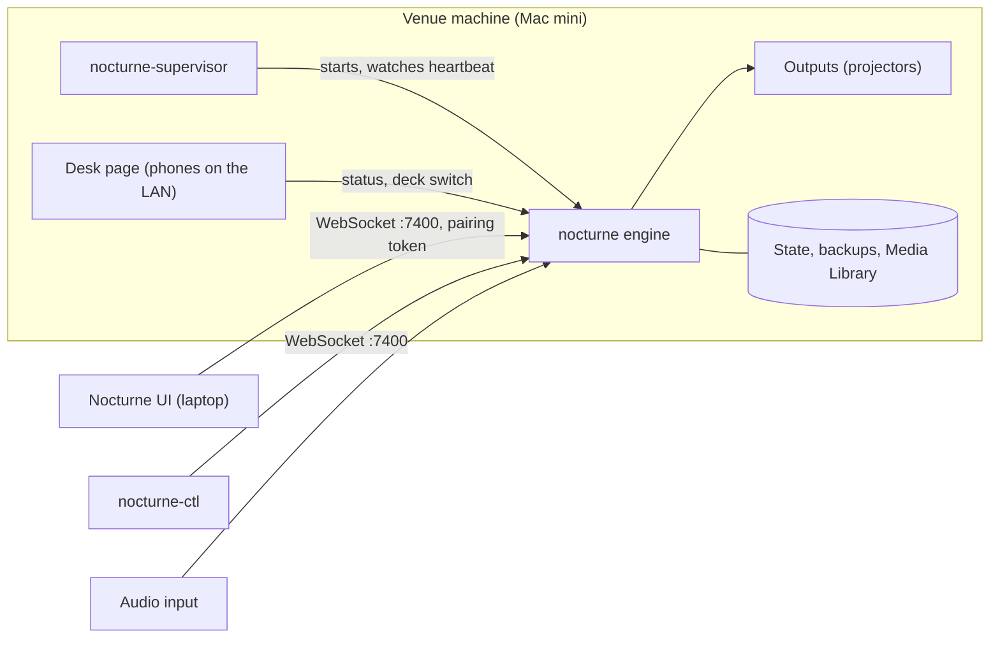
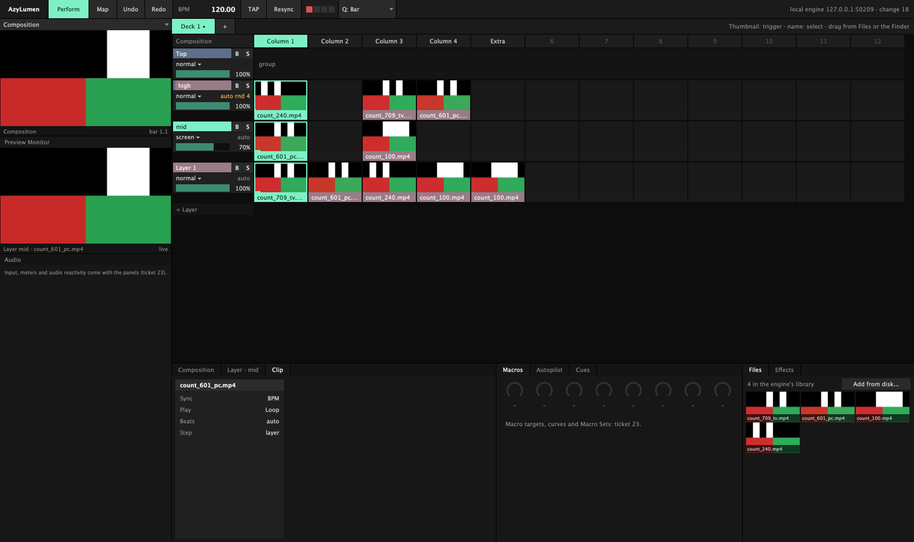

# Nocturne

A live VJ instrument for macOS: a C++20 and Metal engine with a JUCE UI, built to run a club night unattended and
to be played live.


<sub>The example show below. Footage: public-domain films (archive.org) and Beeple VJ loops (CC BY).</sub>

- **Clip grid:** decks of columns, beat-quantised triggers, Autopilot, transitions, text and generator clips.
- **Effects:** fused GPU effect chains on clips, layers, groups and the composition; a curated set of ISF shaders;
  presets, macros, beat LFOs and audio-reactive modulators (band envelopes, kick, snare, hat).
- **Mapping:** screens and slices with corner pin, Bezier warp grids, soft edges, masks and a test card, for one
  projector or many.
- **Show-proof:** a supervisor that restarts a crashed or hung engine on the same clip and beat in a fraction of a
  second, state that survives restarts and power cuts, and fault-injection tests for unplugged displays, drives and
  audio interfaces.
- **Several venues:** every venue machine runs its own show and needs nothing else during a gig; one UI connects to any of them over the LAN or Tailscale, edits it directly and watches all of them.
- **Resolume import:** compositions and Advanced Output mappings, with a report of everything that was approximated
  or left out.

Status: early. It has played real club nights on a Mac mini, and the interfaces still change. macOS only for now.

## How it is built

- **Engine and UI are separate processes** speaking one WebSocket protocol, locally or across the network
  (`docs/adr/0002`, `0010`); a UI crash never touches the show.
- **The render thread never waits:** decoding, shader compilation, text layout, saving and recording all run on their
  own threads, and every effect chain is compiled before it can be triggered (`docs/adr/0009`: chains fuse into as few
  GPU passes as possible).
- **Built to survive a night alone:** a supervisor restarts a crashed or hung engine on the same clip and beat, state is
  written atomically and backed up, files that crashed the engine are skipped from then on, and
  `tests/resilience_test.cpp` injects each failure (drives pulled, displays power-cycled, disks full, clients hung).
- **Measured on the target machine:** a 2018 Mac mini with Intel UHD 630 is the show machine (`docs/adr/0008`);
  `tools/bench-mini.sh` and soak runs judge frame rate, hitches, memory and CPU trends against a baseline before a
  version is tagged good (`docs/show-machine.md`).
- **Decisions are written down:** `docs/adr/` records each architecture decision and what it replaced.



Measured on the show machine (2018 Mac mini, Intel UHD 630, three 1080p output windows at 60 Hz, `bench/baseline.json`):
59.9 fps average render rate in the typical scenario, 11.2 ms average GPU time per frame; back on the same clip and
beat about 0.2 s after an engine crash and 2.2 s after a hang.

The public history starts at one commit squashed from private development, so earlier benchmark results and tags are
not part of this repository.

## Build

macOS 14 or later (Apple silicon or Intel), the Xcode command line tools, CMake 3.24+ and Homebrew `ffmpeg`.

```sh
tools/make-signing-identity.sh   # once per machine: the local "Nocturne Dev" code-signing identity
cmake -S . -B build              # Universal (arm64 + x86_64)
cmake --build build -j8          # build/Nocturne.app and build/Nocturne UI.app
(cd build && ctest --output-on-failure)
```

JUCE, glslang and SPIRV-Cross are downloaded by CMake at configure time.

## Run

```sh
build/nocturne --windowed                   # the engine; borderless fullscreen without --windowed
build/nocturne --virtual 3                  # three simulated displays as windows
open "build/Nocturne UI.app"                # the UI, connects to the engine on this machine
build/nocturne-ctl watch                    # a command-line client: prints the composition and every change
```



The engine serves its composition over WebSocket on port 7400; the UI and `nocturne-ctl` are clients, so the UI can run
on another machine (`--args --host NAME`). A client on another machine needs the engine machine's pairing token
(`nocturne-ctl token` there prints it; see `SECURITY.md`); clients on the same machine need none.
`nocturne --help` lists the engine's options, and `docs/reference.md` the `nocturne-ctl` commands.

## Example show

The repository ships no footage. `examples/first-show/show.json` is a small show (two layers, four columns, a column
Autopilot every 8 bars) built from free clips. Download them, save each under the file name below in
`examples/first-show/`, then start the engine on it:

```sh
build/nocturne --windowed --composition examples/first-show/show.json
```

| File name | Clip | Source | Licence |
|---|---|---|---|
| `serpentine.mp4` | Danse serpentine (c. 1897) | [archive.org](https://archive.org/details/danse-serpentine-par-mme-bob-walter) | Public domain |
| `diagonale.mp4` | Viking Eggeling, Symphonie Diagonale (1924) | [archive.org](https://archive.org/details/SymphonieDiagonale) | Public domain |
| `opus3.mp4` | Walter Ruttmann, Lichtspiel Opus III (1924) | [archive.org](https://archive.org/details/LichtspielOpusIII) | Public domain |
| `moon.mp4` | NASA SVS 14992, Lunar Near and Far Side Phases | [Wikimedia Commons](https://commons.wikimedia.org/wiki/File:Lunar_Near_and_Far_Side_Phases_(SVS14992_-_Waxing_4K).webm) | Public domain (NASA) |
| `beeple_scream.mp4`, `beeple_jahara.mp4`, `beeple_narrow_gultch.mp4` | Beeple VJ loops | [beeple-crap.com](https://www.beeple-crap.com/vjloops) | Creative Commons Attribution: credit "Beeple" |

Nocturne plays H.264, HEVC, ProRes and HAP; convert other formats with ffmpeg (a keyframe every second plays best). A
clip that is missing leaves its cell empty, and any file can be dragged from the UI's browser onto the grid instead.

## Documentation

- `docs/reference.md`: the engine, `nocturne-ctl`, the UI and the file formats, feature by feature.
- `docs/show-machine.md`: setting up an unattended show machine, remote access, benchmarks and resilience tests.
- `docs/adr/`: architecture decisions. `CONTEXT.md`: the domain language.
- `docs/licence-notes.md`: dependency and shader licences.

## Contributing and licence

See `CONTRIBUTING.md`: every commit is signed off under the DCO, no CLA. Security reports: `SECURITY.md`.

Nocturne is licensed under the GNU Affero General Public License v3.0 or later (`LICENSE`). Third-party code keeps its
own licence next to it in `third_party/`.
