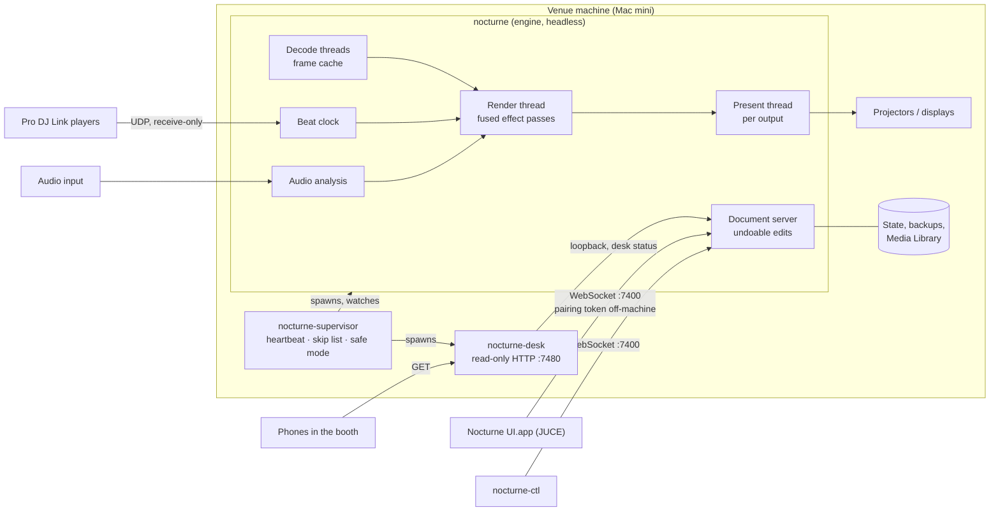

# Nocturne

**A live VJ instrument for macOS that runs a club night unattended and can still be played by hand.**
C++20 + Metal render engine, separate JUCE UI, one WebSocket protocol between them.

[](https://github.com/Azylume/nocturne/actions/workflows/ci.yml)
[](LICENSE)


<sub>The Perform view of the JUCE UI. Project page: [work.azylume.dev](https://work.azylume.dev/#nocturne).</sub>

---

## What it does

- **Clip grid.** Decks of columns and layers, beat-quantised triggers, per-layer and per-column Autopilot,
  beat-timed transitions (alpha, wipe, dissolve, push), text and generator clips.
- **Effects.** Effect chains on clips, layers, groups and the composition, compiled into fused GPU passes.
  A curated set of [ISF](third_party/isf/) shaders, user ISF shaders, a Classic effect pack, presets.
- **Modulation.** Beat LFOs, audio-reactive modulators (level, bands, kick, snare, hat) and Macros, evaluated once per
  frame on the render thread with no shader recompiles.
- **Beat sync.** An own beat clock (tap, nudge, resync) that can follow Pro DJ Link players on the venue network
  ([`src/djlink/`](src/djlink/), receive-only), with Sections and Cues ([`docs/cues.md`](docs/cues.md)).
- **Projection mapping.** Screens and slices with corner pin, Bezier warp grids, soft edges, polygon masks, per-screen
  colour and a test card; one projector or many, each on its own present thread.
- **Show-proof.** A supervisor restarts a crashed or hung engine on the same clip and beat, state survives restarts
  and power cuts, and files that crashed the engine are skipped from then on.
- **Several venues.** Every venue machine runs its own show and needs nothing else during a gig; one UI (the
  Director) connects to any of them over the LAN or Tailscale and edits it directly.
- **Media.** H.264, HEVC, ProRes and HAP (own HAP decoder and encoder); a content-addressed Media Library, so moving
  or renaming files never breaks a clip. Recording to HEVC or ProRes.
- **Resolume import.** Compositions and Advanced Output mappings, with a report of everything that was approximated
  or left out.


## Architecture



**Engine** (`nocturne`, [`src/engine/`](src/engine/), [`src/media/`](src/media/), [`src/output/`](src/output/)).
A headless process that owns the composition and renders it once per frame on a render thread that never waits:
decoding, shader compilation, text layout, saving and recording each run on their own threads, and every effect chain
is compiled before it can be triggered. Each display has its own present thread paced by its own display link, so one
slow output cannot stall the others ([ADR 0003](docs/adr/0003-output-per-thread-presentation.md)).

**Protocol** ([`src/protocol/`](src/protocol/), [`src/net/`](src/net/)). One WebSocket protocol on port 7400 carries
edits, show files, media, previews, recording, settings and engine updates. The UI and `nocturne-ctl` are both just
clients, so the UI can sit on another machine. The engine also advertises itself over Bonjour (`_nocturne._tcp`) and
answers NTP-style clock pings on UDP ([ADR 0005](docs/adr/0005-own-beat-clock.md)).

**UI** (`Nocturne UI.app`, [`src/ui/`](src/ui/)). A dense, custom-drawn JUCE interface in its own process and its own
signed bundle ([ADR 0002](docs/adr/0002-separate-engine-and-juce-ui.md),
[ADR 0010](docs/adr/0010-ui-ships-as-its-own-app-bundle.md)); a UI crash never touches the show. Local previews share
the engine's IOSurfaces with no copy.

**Supervisor** (`nocturne-supervisor`, [`src/app/supervisor.cpp`](src/app/supervisor.cpp),
[`src/supervisor/`](src/supervisor/)). Starts the engine with a heartbeat pipe, restarts it at once on a crash and
after 2 s without a finished frame (`--hang-timeout`), and switches to safe mode after 3 crashes in 60 s. It also runs
the venue desk and restarts it when it stops.

**Venue desk** (`nocturne-desk`, [`src/desk/`](src/desk/)). A small read-only web page for phones in the booth:
tonight's lineup and the live deck. It talks to the engine over loopback and cannot send protocol commands.

**Venues and media** ([`src/venues/`](src/venues/), [`src/upload/`](src/upload/), [`src/sync/`](src/sync/)). Every
venue machine is self-contained ([ADR 0011](docs/adr/0011-self-contained-venue-machines.md)): its own composition,
beat clock and Media Library keyed by content hash
([ADR 0007](docs/adr/0007-content-addressed-media-library.md)). It pulls only the media its own show uses, from
object storage, outside its gig window.

The domain language (Composition, Deck, Column, Layer, Venue, Director, Gig, ...) is defined in
[`CONTEXT.md`](CONTEXT.md).

## Engineering highlights

### Built to survive a night alone

- **Crash and hang recovery.** Before opening a clip or compiling a chain the engine records it in `inflight.json`;
  after a crash or hang the supervisor moves it to a skip list, so the same file cannot take the show down twice.
  State is written atomically (write-rename) off the render thread and backed up every minute. A restart is back on
  the same clip and beat in about 0.2 s after a crash and 2.2 s after a hang
  ([`docs/reference.md`](docs/reference.md)).
- **Fault injection.** [`tests/resilience_test.cpp`](tests/resilience_test.cpp) injects each failure into an engine
  harness: clips truncated, deleted or half-copied while playing, a media drive force-detached, an unplugged audio
  device, a projector power-cycled five times, hung and crashed UIs, GPU overload, a full disk and odd composition
  files. An odd-media corpus (corrupt, VFR, rotated, 10-bit, interlaced, VP9, AV1, ...) must play or be refused
  without stalling the render thread.
- **Soak and chaos runs** on the show machine: a 30-minute supervised soak judged on memory, fps, hitch and CPU trends
  ([`bench/soak_report.py`](bench/soak_report.py)), and a scripted chaos rehearsal that kills, hangs and starves the
  engine while it plays ([`tools/chaos-mini.sh`](tools/chaos-mini.sh)).

### Performance is measured on the target, and gated

The v1 show machine is a 2018 Mac mini with Intel UHD 630
([ADR 0008](docs/adr/0008-intel-mac-mini-is-the-v1-show-machine.md)), so the performance budget is set by that GPU,
not by Apple silicon. [`tools/bench-mini.sh`](tools/bench-mini.sh) builds, deploys and runs scenarios on the Mini and
fails the run if the *typical* scenario (5 layers, 12 effects, three 1080p outputs at 60 Hz) drops below 59.5 fps,
shows more than 0.05 hitches/s per output, compiles a pipeline mid-show, or is more than 10% slower on the GPU than
the baseline. Versions are tagged good only when it passes ([`docs/show-machine.md`](docs/show-machine.md)).

Current baseline ([`bench/baseline.json`](bench/baseline.json), *typical*): **59.93 fps** average render rate,
**11.22 ms** average GPU time per frame (12.41 ms p95).

Effect chains compile into as few GPU passes as possible and blend the last one with fixed-function blending. On the
Mini this cut GPU time by 35-40%, and took 5 layers of Transform + Colorize + Edge from 45 fps / 20.4 ms to
60 fps / 13.3 ms ([ADR 0009](docs/adr/0009-effect-chains-compile-into-fused-passes.md)).

### Security model

Nocturne is built for a trusted LAN or a tailnet; [`SECURITY.md`](SECURITY.md) documents exactly what it exposes.

- **Pairing.** A client from another machine must present the machine's 32-byte pairing token in its first `hello`,
  or the connection is closed; the comparison is constant-time ([`src/net/pairing.cpp`](src/net/pairing.cpp)).
  Only loopback clients (`127.0.0.1`, `::1`) are exempt ([`src/net/websocket.mm`](src/net/websocket.mm)).
- **Path confinement.** A remote client can only name files inside the show, media, library, recording and state
  folders: absolute paths only, no `..`, symlinks resolved before the check
  ([`src/protocol/remote_files.cpp`](src/protocol/remote_files.cpp)).
- **Signed updates.** A pushed engine bundle is installed only when it satisfies the designated requirement of the
  running bundle's signer; an ad-hoc-signed engine refuses pushed bundles
  ([`src/engine/bundle_update.cpp`](src/engine/bundle_update.cpp), fixtures in [`tests/signing/`](tests/signing/)).
- **Read-only desk.** The venue desk answers `GET` only and asks the engine nothing but its status.

### Decisions are written down

Every architecture decision is an ADR, including what it replaced and what it costs:

| ADR | Decision |
|---|---|
| [0001](docs/adr/0001-cpp-metal-engine.md) | C++20 and Metal (metal-cpp) for the engine |
| [0002](docs/adr/0002-separate-engine-and-juce-ui.md) | Engine and UI are separate processes; the UI is JUCE |
| [0003](docs/adr/0003-output-per-thread-presentation.md) | Every output presents on its own thread |
| [0004](docs/adr/0004-gop-cache-instead-of-dxv.md) | H.264/HEVC with a GPU frame cache instead of DXV |
| [0005](docs/adr/0005-own-beat-clock.md) | Own beat clock sync instead of Ableton Link |
| [0006](docs/adr/0006-full-replication-promotable-main.md) | Full replication with a promotable main (superseded by 0011) |
| [0007](docs/adr/0007-content-addressed-media-library.md) | One content-addressed media library per machine |
| [0008](docs/adr/0008-intel-mac-mini-is-the-v1-show-machine.md) | The 2018 Intel Mac mini is the v1 show machine |
| [0009](docs/adr/0009-effect-chains-compile-into-fused-passes.md) | Effect chains compile into fused GPU passes |
| [0010](docs/adr/0010-ui-ships-as-its-own-app-bundle.md) | The UI ships as its own signed app bundle |
| [0011](docs/adr/0011-self-contained-venue-machines.md) | Every venue machine is self-contained |
| [0012](docs/adr/0012-agpl-licence.md) | AGPL-3.0-or-later, contributions under the DCO |
| [0013](docs/adr/0013-deck-switches-only-at-a-time-of-day-or-by-hand.md) | A deck switches only at a time of day or by hand |

### Tested on the GPU

Render tests compare against golden images in [`tests/golden/`](tests/golden/); the UI has its own suite, including
headless smoke tests that connect the window to a harness engine. CI ([`ci.yml`](.github/workflows/ci.yml)) builds
on macOS 15 and runs both suites except the real-time and hardware tests listed in
[`.github/realtime-tests.txt`](.github/realtime-tests.txt), plus a DCO check on every pull request.

## Getting started

**Requirements:** macOS 14 or later (Apple silicon or Intel), the Xcode command line tools, CMake 3.24+ and Homebrew
`ffmpeg`. JUCE, glslang and SPIRV-Cross are downloaded by CMake at configure time.

```sh
tools/make-signing-identity.sh   # once per machine: the local "Nocturne Dev" code-signing identity
cmake -S . -B build              # Universal (arm64 + x86_64)
cmake --build build -j8          # build/Nocturne.app and build/Nocturne UI.app
(cd build && ctest --output-on-failure)
```

The test suite renders on the GPU and needs a logged-in session. To build a single architecture as CI does:
`cmake -S . -B build -DCMAKE_OSX_ARCHITECTURES=arm64`.

### Run

```sh
build/nocturne --windowed                   # the engine; borderless fullscreen without --windowed
build/nocturne --virtual 3                  # three simulated displays as windows
open "build/Nocturne UI.app"                # the UI, connects to the engine on this machine
build/nocturne-ctl watch                    # command-line client: prints the composition and every change
```

To control an engine on another machine, start the UI with `open "build/Nocturne UI.app" --args --host NAME` and
type that machine's pairing token into the venue menu (`nocturne-ctl token` on the engine machine prints it;
`nocturne-ctl` itself takes `--token` or `NOCTURNE_TOKEN`). `nocturne --help` lists
the engine's options; [`docs/reference.md`](docs/reference.md) covers every `nocturne-ctl` command.

### Example show

The repository ships no footage. [`examples/first-show/show.json`](examples/first-show/show.json) is a small show
(two layers, four columns, a column Autopilot every 8 bars) built from free clips. Download them, save each under the
file name below in `examples/first-show/`, then:

```sh
build/nocturne --windowed --composition examples/first-show/show.json
```

| File name | Clip | Source | Licence |
|---|---|---|---|
| `serpentine.mp4` | Danse serpentine (c. 1897) | [archive.org](https://archive.org/details/danse-serpentine-par-mme-bob-walter) | Public domain |
| `diagonale.mp4` | Viking Eggeling, Symphonie Diagonale (1924) | [archive.org](https://archive.org/details/SymphonieDiagonale) | Public domain |
| `opus3.mp4` | Walter Ruttmann, Lichtspiel Opus III (1924) | [archive.org](https://archive.org/details/LichtspielOpusIII) | Public domain |
| `moon.mp4` | NASA SVS 14992, Lunar Near and Far Side Phases | [Wikimedia Commons](https://commons.wikimedia.org/wiki/File:Lunar_Near_and_Far_Side_Phases_(SVS14992_-_Waxing_4K).webm) | Public domain (NASA) |
| `beeple_scream.mp4`, `beeple_jahara.mp4`, `beeple_narrow_gultch.mp4` | Beeple VJ loops | [beeple-crap.com](https://www.beeple-crap.com/vjloops) | Creative Commons Attribution: credit "Beeple" |

A clip that is missing leaves its cell empty, and any file can be dragged from the UI's browser onto the grid instead.
Other formats convert with ffmpeg (a keyframe every second plays best).

<details>
<summary>The example show playing its four columns (GIF, 9 MB)</summary>


<sub>Footage: public-domain films (archive.org) and Beeple VJ loops (CC BY).</sub>
</details>

### Running a show machine

[`docs/show-machine.md`](docs/show-machine.md) covers setting up a Mac mini as an unattended show machine (autostart,
permissions, Tailscale), the benchmark, profiling with Tracy, and the resilience runs.

## Project status

Early. Nocturne has played real club nights on a Mac mini, and its interfaces still change. macOS only for now.

The public history starts at one commit squashed from private development, so earlier benchmark results and tags are
not part of this repository.

## Documentation

| | |
|---|---|
| [`docs/reference.md`](docs/reference.md) | The engine, `nocturne-ctl`, the UI and the file formats, feature by feature |
| [`docs/show-machine.md`](docs/show-machine.md) | Unattended show machine, remote access, benchmarks, resilience tests |
| [`docs/cues.md`](docs/cues.md) | Sections, Cues and who switches the deck |
| [`docs/adr/`](docs/adr/) | Architecture decisions |
| [`CONTEXT.md`](CONTEXT.md) | Domain language |
| [`docs/licence-notes.md`](docs/licence-notes.md) | Dependency and shader licences |

## Contributing

Contributions are welcome under the [Developer Certificate of Origin](https://developercertificate.org/): sign off
every commit (`git commit -s`); there is no CLA and you keep your copyright. CI rejects pull requests with unsigned
commits. See [`CONTRIBUTING.md`](CONTRIBUTING.md) for the build, the golden-image workflow and what a good change looks
like, and [`CODE_OF_CONDUCT.md`](CODE_OF_CONDUCT.md).

## Security

Please report vulnerabilities privately through GitHub's "Report a vulnerability" on the Security tab, not in a
public issue. Scope and the network trust model are in [`SECURITY.md`](SECURITY.md).

## Licence and credits

Nocturne is licensed under the **GNU Affero General Public License v3.0 or later** ([`LICENSE`](LICENSE),
[ADR 0012](docs/adr/0012-agpl-licence.md)). Third-party code keeps its own licence next to it in
[`third_party/`](third_party/):

- **ISF shaders:** a curated set from VIDVOX's ISF-Files and from gl-transitions, MIT, vendored verbatim with their
  licence files in [`third_party/isf/`](third_party/isf/); per-shader credits and the selection rules are in
  [`docs/licence-notes.md`](docs/licence-notes.md).
- **AMD FidelityFX Super Resolution 1** (MIT), ported to Metal in
  [`src/engine/fsr_upscaler.cpp`](src/engine/fsr_upscaler.cpp) with AMD's notice.
- **metal-cpp** (Apache-2.0), **nlohmann/json** (MIT), **doctest** (MIT, tests), **stb_dxt** (MIT / public domain);
  **JUCE** (AGPLv3), **glslang** and **SPIRV-Cross** fetched at configure time.
- **HAP and snappy** are re-implemented from their published specifications; Pro DJ Link from documented packet
  layouts. No code is copied from those projects.

**Compatibility with Resolume.** Nocturne uses Resolume's vocabulary where it already names a concept, imports
Resolume compositions and Advanced Output mappings ([`src/import/`](src/import/)), and ships a **Classic** effect pack
with built-in looks that mirrors the effects of an established VJ app and can import that app's presets from the same
machine. Visual parity is measured by [`tools/classic_parity.py`](tools/classic_parity.py) against reference
frames captured with [`tools/arena-capture/`](tools/arena-capture/README.md); only the scores are committed
([`docs/research/classic-parity.json`](docs/research/classic-parity.json)). Nocturne is not affiliated with or
endorsed by Resolume; Resolume and Resolume Arena are trademarks of their owner.
