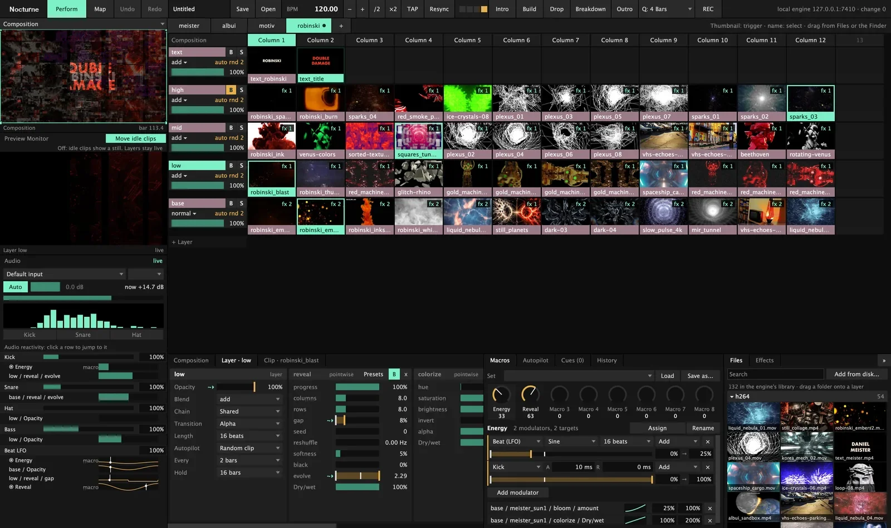
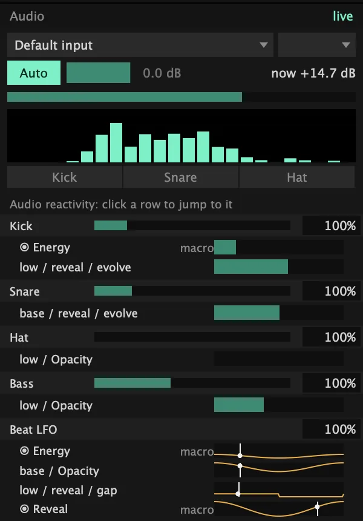
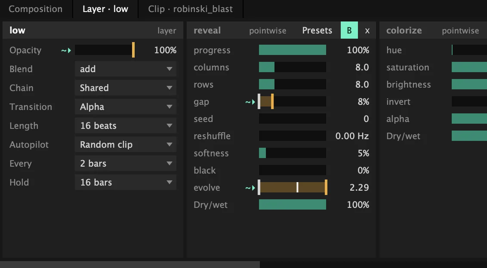
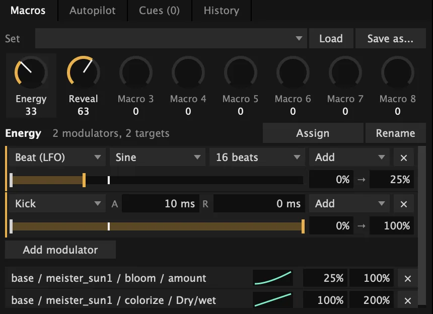
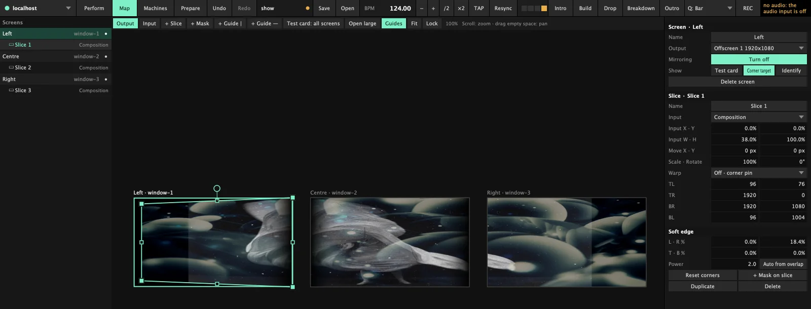
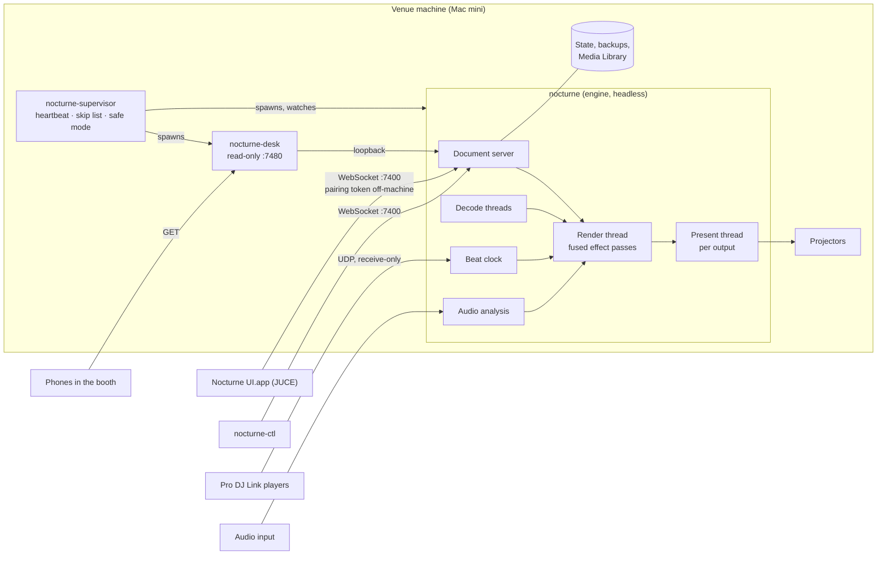

# Nocturne

**Visuals for the long night: beat-locked, mapped onto the room, and still playing when nobody is watching.**

[](https://github.com/Azylume/nocturne/actions/workflows/ci.yml)
[](LICENSE)




## Why this exists

A UI crash used to take the whole show down. One slow projector dragged the others with it. Moving a show to
another Mac meant every clip went missing. Nocturne is the VJ tool built around those nights: the engine plays
on its own, the UI is just a window into it, and the show knows its clips by content, not by where they live.

<p align="center">
  
  <br><sub>The example show from this repo, playing on its own. Footage: public-domain films (archive.org) and Beeple VJ loops (CC BY).</sub>
</p>

## At the gig

**Play clips on the beat**
- Decks of columns and layers. Fire a clip, a column or a whole deck; it lands on the next beat, bar or N bars.
- Autopilot walks a layer, or the whole column, through your clips every few bars.
- Transitions timed in beats: cut, alpha, wipe, dissolve, push. Random Jump, reverse and scrub, even on long clips.
- Text clips and built-in generators (strobe, lines, checker, noise, ...) for when the folder runs dry.

**Stay in time with the DJ**
- Follows the CDJs over Pro DJ Link. Lose the link and it keeps the last tempo and plays on. Tap, nudge and
  resync when you'd rather trust your ears.
- Mark the Sections live (intro, build, drop, breakdown, outro) and let Cues do the rest: "when the Drop starts, fire
  column 1" ([`docs/cues.md`](docs/cues.md)).
- Plan the night as a Gig. Each DJ gets a deck, and it switches at the set time or by hand. Nothing else switches
  it, so an early drop never puts the wrong DJ's visuals on the wall.

**Shape the picture**
- Effect chains on clips, layers, groups and the whole composition. Presets you save once and drag onto anything.
- A curated set of ISF shaders built in, plus your own `.fs` files from the machine's user folder.
- Eight Macro knobs per composition or group, moved by beat LFOs or by the room: level, bands, kick, snare, hat.

<table><tr>
  <td rowspan="2" width="34%" valign="top"></td>
  <td valign="top"></td>
</tr><tr><td valign="top"></td></tr></table>

**Map it onto the room**
- Screens and slices with corner pin, Bezier warp grids, soft edges for blending projectors, masks and a test card.
- Each output runs on its own thread, so one slow projector doesn't drag the others down.
- Power-cycle a projector mid-set: its screen comes back where it was.



**Media and recording**
- H.264, HEVC, ProRes and HAP, with its own HAP encoder (`nocturne-hap-encode`).
- Clips are known by their content, not their path. Move or rename the folder; the show still finds them.
- Record the composition or a single screen to HEVC or ProRes while you play.

**Bring your Resolume shows**
- Opens Resolume compositions and Advanced Output mappings, and writes a report of everything converted,
  approximated or left out.
- The Classic effect pack covers the familiar effects of an established VJ app, and can load that app's presets from
  the same Mac.

**Leave it running**
- Crash: back on the same clip and beat in about 0.2 s. Freeze: about 2.2 s. The culprit file is skipped after.
- The show survives restarts and power cuts, and is backed up every minute while you edit.
- The UI is its own app. If it crashes, the projectors don't notice.
- One Mac per venue, each playing its own show; reach any of them over the LAN or Tailscale. A read-only phone
  page in the booth shows tonight's lineup and whose deck is live.

## What you need

- A Mac on macOS 14 or later, Apple silicon or Intel. The reference show machine is a 2018 Intel Mac mini
  (UHD 630), benchmarked with three 1080p outputs at 60 Hz.
- Optional: an audio input for audio-reactive modulation, Pro DJ Link players on the network to follow the DJ.
- To build: Xcode command line tools, CMake 3.24+, Homebrew `ffmpeg`.

## Run it

```sh
tools/make-signing-identity.sh   # once per Mac
cmake -S . -B build && cmake --build build -j8
build/nocturne --windowed        # the engine
open "build/Nocturne UI.app"     # the UI
```

The repo ships no footage. To load the example show, save these free clips into `examples/first-show/` under the
names shown. Then run `build/nocturne --windowed --composition examples/first-show/show.json`.

- `serpentine.mp4`, `diagonale.mp4`, `opus3.mp4`: [Danse serpentine](https://archive.org/details/danse-serpentine-par-mme-bob-walter),
  [Symphonie Diagonale](https://archive.org/details/SymphonieDiagonale), [Lichtspiel Opus III](https://archive.org/details/LichtspielOpusIII) (public domain).
- `moon.mp4`: [NASA SVS 14992](https://commons.wikimedia.org/wiki/File:Lunar_Near_and_Far_Side_Phases_(SVS14992_-_Waxing_4K).webm) (public domain).
- `beeple_scream.mp4`, `beeple_jahara.mp4`, `beeple_narrow_gultch.mp4`: [Beeple VJ loops](https://www.beeple-crap.com/vjloops) (CC BY, credit "Beeple").

First time? [`docs/getting-started.md`](docs/getting-started.md) walks from a fresh clone to a show playing on
Autopilot. Coming from Resolume: [`docs/resolume-import.md`](docs/resolume-import.md). To run a Mac mini on its own
for the night, see [`docs/show-machine.md`](docs/show-machine.md).

**Status:** early. It has played real club nights on a Mac mini, and the interfaces still change. macOS only for now.
- No downloadable app yet: you build it.
- No MIDI or OSC control yet. Play it from the UI or `nocturne-ctl`, or let Autopilot and Cues run it.
- No DXV. Convert those clips (`tools/transcode-media.sh` does it for an imported Resolume show).
- Resolume import is a translation, not a copy. Read the report.

Everything else, feature by feature: [`docs/reference.md`](docs/reference.md).

---

## For developers



C++20 engine rendering with Metal, a separate JUCE UI, one WebSocket protocol between them. Domain words:
[`CONTEXT.md`](CONTEXT.md).

- **Engine** (`nocturne`, [`src/engine/`](src/engine/)): headless. The render thread never waits; decoding, shader
  compiles, saving and recording run elsewhere, and each output presents on its own thread.
- **Protocol** ([`src/protocol/`](src/protocol/), [`src/net/`](src/net/)): one WebSocket on port 7400 for edits,
  media, previews and updates. The UI and `nocturne-ctl` are just clients.
- **UI** (`Nocturne UI.app`, [`src/ui/`](src/ui/)): JUCE, its own process and signed bundle; local previews share
  the engine's IOSurfaces with no copy.
- **Supervisor** ([`src/app/supervisor.cpp`](src/app/supervisor.cpp)): restarts the engine on a crash or after 2 s
  without a frame, goes to safe mode after 3 crashes in 60 s, and runs the venue desk.

**Engineering highlights**
- **Recovery and fault injection.** Clips and chains in flight are recorded before they open, so a crash puts them on a
  skip list. [`tests/resilience_test.cpp`](tests/resilience_test.cpp) pulls drives, power-cycles projectors, hangs
  clients, fills the disk and overloads the GPU while the show plays.
- **Benchmark gate.** [`tools/bench-mini.sh`](tools/bench-mini.sh) runs on the 2018 Mac mini and fails below 59.5 fps
  or above 0.05 hitches/s per output. Baseline ([`bench/baseline.json`](bench/baseline.json)): 59.93 fps, 11.22 ms
  GPU per frame. Fusing effect chains into fewer passes took 5 layers from 45 to 60 fps there
  ([ADR 0009](docs/adr/0009-effect-chains-compile-into-fused-passes.md)).
- **Security model.** Clients from other machines need a 32-byte pairing token; only loopback is exempt. Remote
  paths are confined to the show folders, and a pushed engine bundle must be signed by the running one's identity
  ([`SECURITY.md`](SECURITY.md)).
- **Decisions on paper.** Every architecture call, with what it replaced and what it cost, is in [`docs/adr/`](docs/adr/).
- **Tests.** Render tests against golden images, a headless UI suite, and CI on macOS 15 with a DCO check
  ([`ci.yml`](.github/workflows/ci.yml)).

**Build and test**

```sh
tools/make-signing-identity.sh   # once per machine: the local "Nocturne Dev" signing identity
cmake -S . -B build              # Universal (arm64 + x86_64)
cmake --build build -j8
(cd build && ctest --output-on-failure)
```

JUCE, glslang and SPIRV-Cross are fetched at configure time. The suite renders on the GPU and needs a logged-in
session. Setting up and benchmarking a show machine: [`docs/show-machine.md`](docs/show-machine.md).

## Licence and credits

[AGPL-3.0-or-later](LICENSE). Curated ISF shaders from VIDVOX and gl-transitions (MIT), the AMD FSR 1 port and the
other third-party credits are in [`docs/licence-notes.md`](docs/licence-notes.md). Nocturne is not affiliated with or
endorsed by Resolume. By Okonai, under Azylume.

[Contributing (DCO, no CLA)](CONTRIBUTING.md) · [Report a vulnerability](SECURITY.md) · [Code of conduct](CODE_OF_CONDUCT.md)
